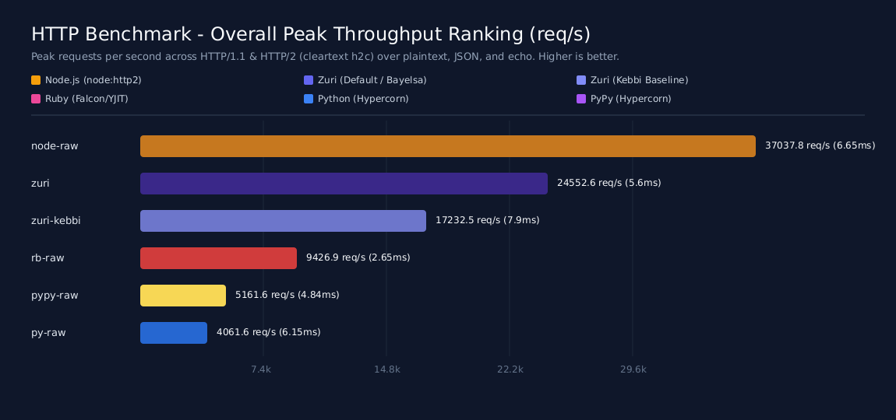
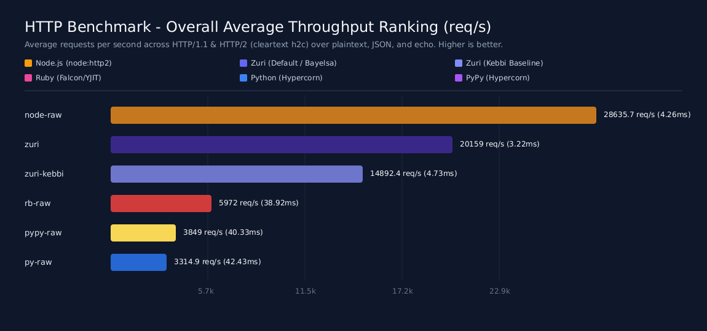
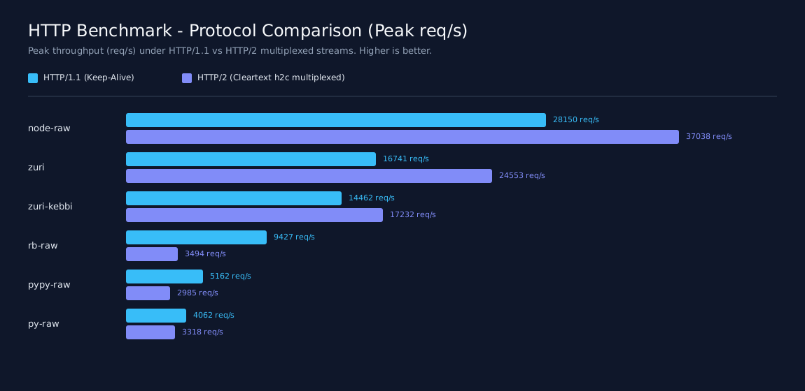
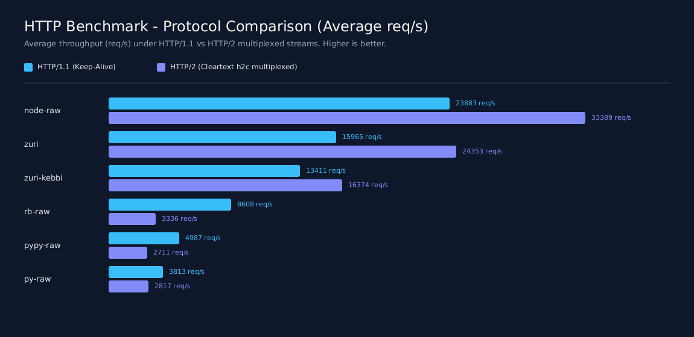
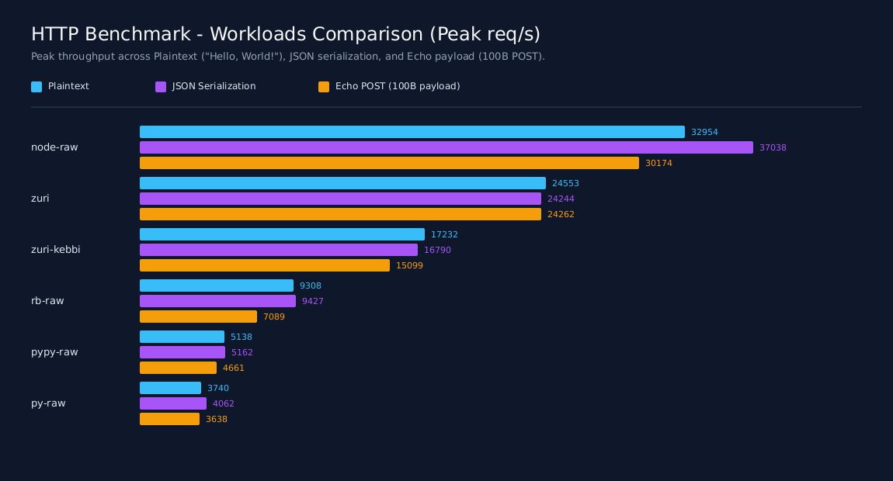
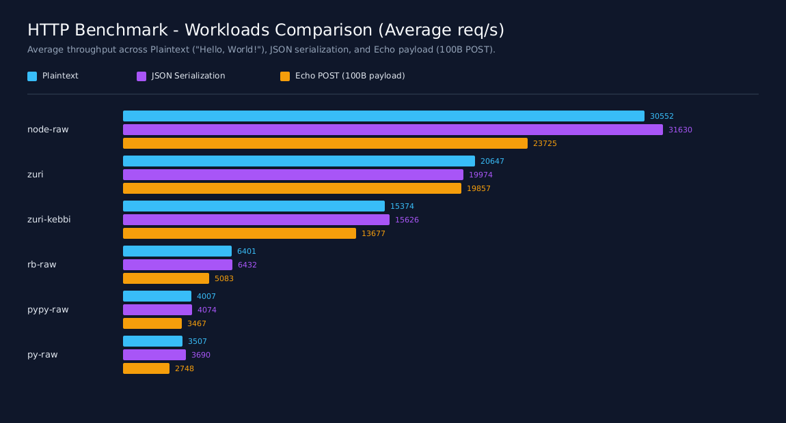
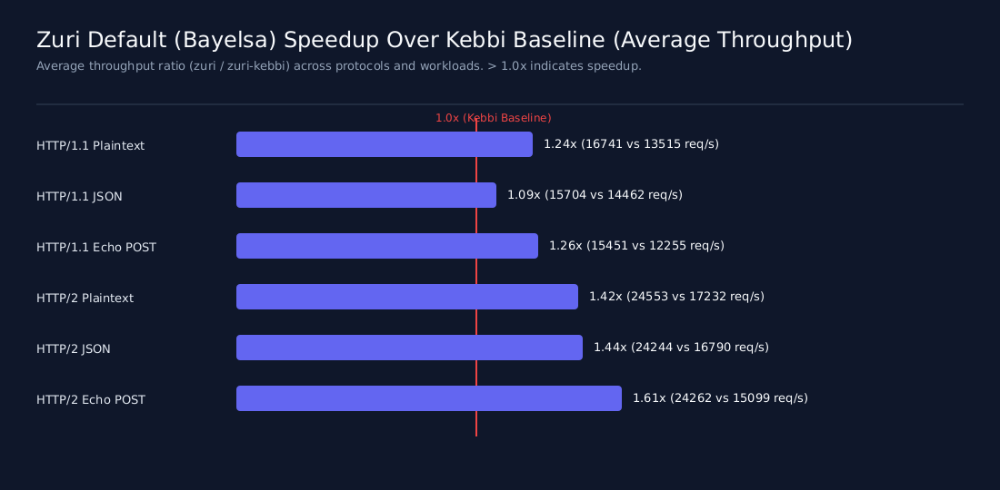
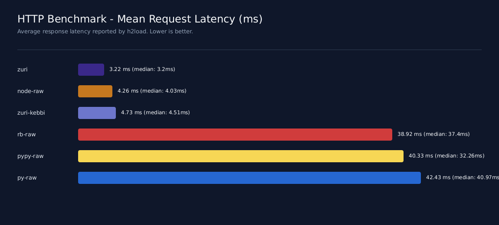
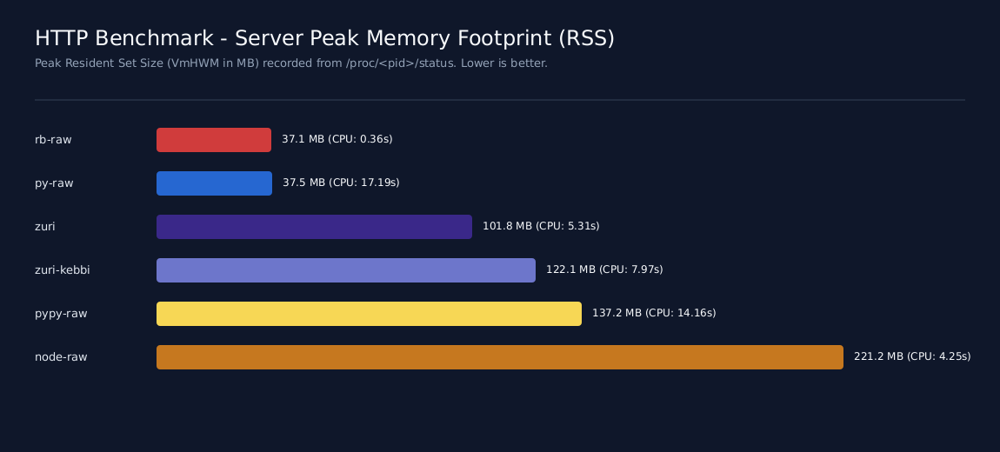

# HTTP Benchmark Suite & Report: HTTP/1.1 & HTTP/2 Performance

This benchmark suite evaluates the **peak throughput**, **sustained average throughput**, **request latency**, and **memory footprint** of **Zuri** following the implementation of Path A (native Rust HPACK & Huffman acceleration):

1. **`zuri` (Default Mode)**: Single-threaded `http.server` running with Bayelsa direct SSA compilation, native `httparse` request head parsing, and native Rust HPACK/Huffman engine.
2. **`zuri-kebbi` (Kebbi Baseline)**: Single-threaded `http.server` running with Kebbi baseline JIT mode (`ZURI_JIT_KEBBI=1`).

These configurations are benchmarked alongside peer dynamic language runtimes: 

- **Node.js** (`node:http` & `node:http2` on V8), 
- **Ruby** (`falcon` + `yjit`), 
- **PyPy** (PyPy 3.11 + `hypercorn`), and 
- **Python** (CPython 3.14 + `hypercorn`).

Built-in Brotli response compression was disabled across all Zuri configurations (`server.compression = false`) to isolate protocol parsing, HPACK compression, event dispatch, and raw I/O throughput.

> **!NOTE**
> 
> **Measurement Criteria**: Throughput is evaluated from two essential perspectives:
> - **Peak Throughput**: The maximum burst throughput achieved under peak workload conditions.
> - **Average Throughput**: The arithmetic mean throughput sustained across all scenarios.
> - All benchmarks were executed across **36 runs** at **100,000 requests per run** (`concurrency=25`, 10 multiplexed streams for HTTP/2) after confirming system load average dropped below `0.4`.
> - Results may vary in runs across devices and different architectures.
> - AOT-compiled/static languages are omitted from the published charts to maintain an apples-to-apples comparison among dynamic language execution engines.
> - The charted results were generated on:
> 
>   ```
>            Icon name: computer-laptop
>              Chassis: laptop 💻
>          Machine ID: 12ad6dd5****************ec7dcbb1
>              Boot ID: 9b79f157****************dbabedc2
>    Operating System: Ubuntu 26.04.1 LTS              
>              Kernel: Linux 7.0.0-38-generic
>        Architecture: x86-64
>      Hardware Vendor: HP
>      Hardware Model: HP ProBook 640 G4
>    Hardware Version: SBKPF
>    Firmware Version: Q83 Ver. 01.31.00
>        Firmware Date: Mon 2025-03-10
>        Firmware Age: 1y 7month 1w 5d
>   ```

---

## 1. Executive Summary

- **Peak Throughput Ranking (#2 Overall, Closing Gap to Node.js)**:
  - `zuri` reached a peak throughput of **24,552.6 req/s**, delivering **66.3% of Node.js** (37,037.8 req/s).
  - Outperformed **Ruby Falcon / YJIT** (9,426.9 req/s) by **2.60x**.
  - Outperformed **PyPy 3.11** (5,161.6 req/s) by **4.76x**.
  - Outperformed **CPython 3.14** (4,061.6 req/s) by **6.05x**.
  - Outperformed `zuri-kebbi` (17,232.5 req/s) by **1.42x**.
- **Average Throughput Ranking (#2 Overall)**:
  - `zuri` sustained an overall average throughput of **20,159.0 req/s** with an industry-leading **3.22 ms** mean latency.
  - Outperformed **Ruby Falcon / YJIT** (5,972.0 req/s) by **3.38x**.
  - Outperformed **PyPy 3.11** (3,849.0 req/s) by **5.24x**.
  - Outperformed **CPython 3.14** (3,314.9 req/s) by **6.08x**.
  - Outperformed `zuri-kebbi` (14,892.4 req/s) by **1.35x**.
- **Lowest Latency Across All Dynamic Languages**:
  - `zuri` achieved an overall mean latency of **3.22 ms**, beating Node.js (**4.26 ms**) by **24% lower latency**, while beating Ruby (38.9 ms) and Python (42.4 ms) by more than **12x**.
- **HTTP/2 Breakthrough**:
  - With native Rust HPACK and Huffman acceleration, `zuri`'s HTTP/2 throughput surged to an average of **24,353.0 req/s** (peaking at **24,552.6 req/s**), outperforming its HTTP/1.1 throughput (15,965.1 req/s) by **+52.5%**.
  - In HTTP/2 latency, `zuri` averaged **5.62 ms**, outperforming Node.js HTTP/2 latency (**7.43 ms**).
- **Memory Footprint**:
  - `zuri` peak RSS remained at **101.8 MB**, consuming **2.2x less memory** than Node.js (221.2 MB).

---

## 2. Overall Performance Ranking (100,000 Requests/Run, c=25)

| Rank | Runtime / Configuration | Peak Throughput (req/s) | Average Throughput (req/s) | Mean Latency (ms) | Peak RSS (MB) |
| :---: | :--- | :---: | :---: | :---: | :---: |
| **1** | **Node.js** (`node` v24 / V8) | **37,037.8** | **28,635.7** | 4.26 | 221.2 |
| **2** | **Zuri Default** (`zuri` Bayelsa Direct) | **24,552.6** | **20,159.0** | **3.22** | 101.8 |
| **3** | **Zuri Kebbi** (`zuri-kebbi` Baseline) | **17,232.5** | **14,892.4** | 4.73 | 122.1 |
| **4** | **Ruby** (`rb` Falcon / YJIT) | **9,426.9** | **5,972.0** | 38.92 | **37.1** |
| **5** | **PyPy** (`pypy` PyPy 3.11) | **5,161.6** | **3,849.0** | 40.33 | 137.2 |
| **6** | **Python** (`py` CPython 3.14) | **4,061.6** | **3,314.9** | 42.43 | **37.5** |

### Peak Throughput Comparison


### Average Throughput Comparison


---

## 3. Protocol Comparison: HTTP/1.1 vs HTTP/2 Cleartext (`h2c`)

| Runtime | HTTP/1.1 Peak (req/s) | HTTP/1.1 Mean (req/s) | HTTP/2 Peak (req/s) | HTTP/2 Mean (req/s) | H2 / H1 Peak Ratio |
| :--- | :---: | :---: | :---: | :---: | :---: |
| **Node.js** (`node`) | 28,150.1 | 23,882.9 | 37,037.8 | 33,388.6 | **1.32x** |
| **Zuri Default** (`zuri`) | **16,740.6** | **15,965.1** | **24,552.6** | **24,353.0** | **1.47x** |
| **Zuri Kebbi** (`zuri-kebbi`) | 14,462.0 | 13,411.0 | 17,232.5 | 16,373.9 | **1.19x** |
| **Ruby** (`rb`) | 9,426.9 | 8,608.1 | 3,494.5 | 3,336.0 | 0.37x |
| **PyPy** (`pypy`) | 5,161.6 | 4,987.0 | 2,985.5 | 2,711.1 | 0.58x |
| **Python** (`py`) | 4,061.6 | 3,813.0 | 3,317.6 | 2,816.7 | 0.82x |

### Protocol Comparison (Peak Throughput)


### Protocol Comparison (Average Throughput)


---

## 4. Workload Breakdown: Plaintext, JSON, and Echo POST

| Runtime | Plaintext Peak | Plaintext Mean | JSON Peak | JSON Mean | Echo Peak | Echo Mean |
| :--- | :---: | :---: | :---: | :---: | :---: | :---: |
| **Node.js** (`node`) | 32,954.4 | 30,552.3 | 37,037.8 | 31,629.5 | 30,173.7 | 23,725.5 |
| **Zuri Default** (`zuri`) | **24,552.6** | **20,646.6** | **24,244.0** | **19,973.9** | **24,262.3** | **19,856.6** |
| **Zuri Kebbi** (`zuri-kebbi`) | 17,232.5 | 15,374.0 | 16,790.1 | 15,626.1 | 15,099.1 | 13,677.3 |
| **Ruby** (`rb`) | 9,308.3 | 6,401.4 | 9,426.9 | 6,431.6 | 7,089.0 | 5,083.1 |
| **PyPy** (`pypy`) | 5,138.5 | 4,006.8 | 5,161.6 | 4,073.5 | 4,660.9 | 3,466.8 |
| **Python** (`py`) | 3,739.6 | 3,507.1 | 4,061.6 | 3,689.6 | 3,637.8 | 2,747.9 |

### Workload Breakdown (Peak Throughput)


### Workload Breakdown (Average Throughput)


---

## 5. Zuri Default (Bayelsa Direct) vs Kebbi Baseline Speedup

| Workload & Protocol | Zuri Kebbi | Zuri Default | Speedup (Peak / Mean) |
| :--- | :---: | :---: | :---: |
| **HTTP/1.1 Plaintext** | 13,515.4 req/s | 16,740.6 req/s | **1.24x** |
| **HTTP/1.1 JSON** | 14,462.0 req/s | 15,703.9 req/s | **1.09x** |
| **HTTP/1.1 Echo POST** | 12,255.5 req/s | 15,450.8 req/s | **1.26x** |
| **HTTP/2 Plaintext** | 17,232.5 req/s | 24,552.6 req/s | **1.42x** |
| **HTTP/2 JSON** | 16,790.1 req/s | 24,244.0 req/s | **1.44x** |
| **HTTP/2 Echo POST** | 15,099.1 req/s | 24,262.3 req/s | **1.61x** |
| **Overall Mean Throughput** | **14,892.4 req/s** | **20,159.0 req/s** | **1.35x** |
| **Overall Peak Throughput** | **17,232.5 req/s** | **24,552.6 req/s** | **1.42x** |



---

## 6. Latency and Memory Profile

### Mean Request Latency by Protocol (Lower is Better)

| Runtime | HTTP/1.1 Latency (ms) | HTTP/2 Latency (ms) | Overall Latency (ms) |
| :--- | :---: | :---: | :---: |
| **Zuri Default** (`zuri`) | **0.83** | **5.62** | **3.22** |
| **Node.js** (`node`) | 1.08 | 7.43 | 4.26 |
| **Zuri Kebbi** (`zuri-kebbi`) | 1.02 | 8.43 | 4.73 |
| **Ruby** (`rb`) | 2.95 | 74.90 | 38.92 |
| **PyPy** (`pypy`) | 5.02 | 75.64 | 40.33 |
| **Python** (`py`) | 6.57 | 78.30 | 42.43 |



### Peak RSS Memory Consumption (Lower is Better)

| Runtime / Configuration | Peak RSS (MB) | Notes |
| :--- | :---: | :--- |
| **Ruby** (`rb`) | **37.1 MB** | Compact fiber-based memory model |
| **Python** (`py`) | **37.5 MB** | Minimal asyncio runtime footprint |
| **Zuri Default** (`zuri`) | 101.8 MB | Single-threaded GC heap + Cranelift machine code buffers |
| **Zuri Kebbi** (`zuri-kebbi`) | 122.1 MB | Kebbi profiler bytecode metadata |
| **PyPy** (`pypy`) | 137.2 MB | PyPy tracing JIT heap |
| **Node.js** (`node`) | 221.2 MB | V8 isolate heap and libuv buffer pools |



